# Laboratory Work No. 3 — Cloud Networking: Amazon VPC

**Student:** Yakovlev Vladyslav  
**Group:** 376 *(verify before submitting)*  
**Specialty:** Informatică aplicată  
**Group number (`k`):** 27; **X = 27 % 30 = 27**  
**Level:** Advanced, Parts 1 and 2 (Tasks 1–14)  
**Region:** `eu-central-1` (Frankfurt)  
**Application repository:** [add GitHub repository URL]

## Objective and result

The aim was to design an isolated AWS VPC, configure public/private networking and controlled access, and migrate the TimeCapsule application from Lab 2 to an application server with PostgreSQL hosted separately in a private subnet. Administrative SSH is routed through a bastion. The PostgreSQL host has no permanent route to the internet; temporary NAT is used for updates.

## Part 1 — Network infrastructure (Tasks 1–7)

### Task 1 — Address plan

VPC CIDR: `10.27.0.0/16`.

| Subnet | Availability Zone | CIDR | First usable EC2 IP | Last usable EC2 IP | Usable IPs |
|---|---|---|---|---|---:|
| public-a | eu-central-1a | `10.27.0.0/24` | `10.27.0.4` | `10.27.0.254` | 251 |
| public-b | eu-central-1b | `10.27.1.0/24` | `10.27.1.4` | `10.27.1.254` | 251 |
| private-a | eu-central-1a | `10.27.10.0/24` | `10.27.10.4` | `10.27.10.254` | 251 |
| private-b | eu-central-1b | `10.27.11.0/24` | `10.27.11.4` | `10.27.11.254` | 251 |

**Answer:** A `/24` has 256 addresses; AWS reserves `.0` (network), `.1` (VPC router), `.2` (DNS), `.3` (reserved), and `.255` (last address). A `/16` has 256 non-overlapping `/24` networks, so 252 remain after allocating four.

### Task 2 — VPC and subnets

Created `timecapsule-dev-vpc` with the four subnets above, using `DNS resolution` and `DNS hostnames`. The screenshot shows the subnet list and CIDRs.

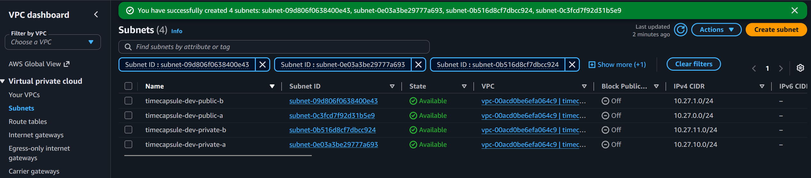

**Answer:** The name `public-a` does not make a subnet public. It requires a default route to an Internet Gateway and publicly addressed resources.

### Task 3 — Internet Gateway and route tables

Created `timecapsule-dev-igw`, `timecapsule-dev-public-rt`, and `timecapsule-dev-private-rt`. Public subnets use `0.0.0.0/0 → IGW`; private subnets retain the local route without permanent internet access.

| Route table | Route destinations | Associated subnets |
|---|---|---|
| `timecapsule-dev-public-rt` | `10.27.0.0/16 → local`, `0.0.0.0/0 → IGW` | public-a, public-b |
| `timecapsule-dev-private-rt` | `10.27.0.0/16 → local` | private-a, private-b |

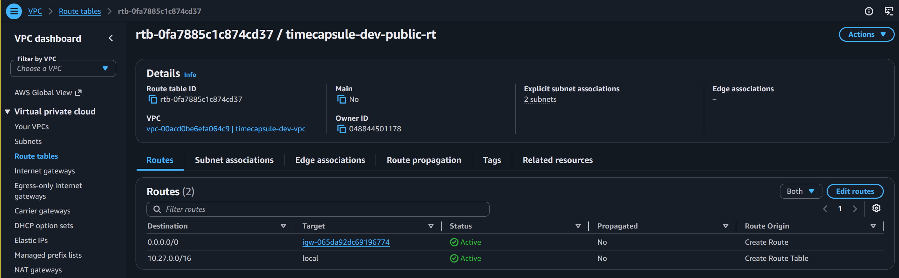
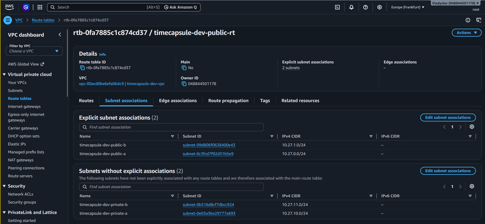
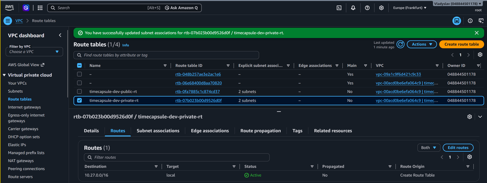
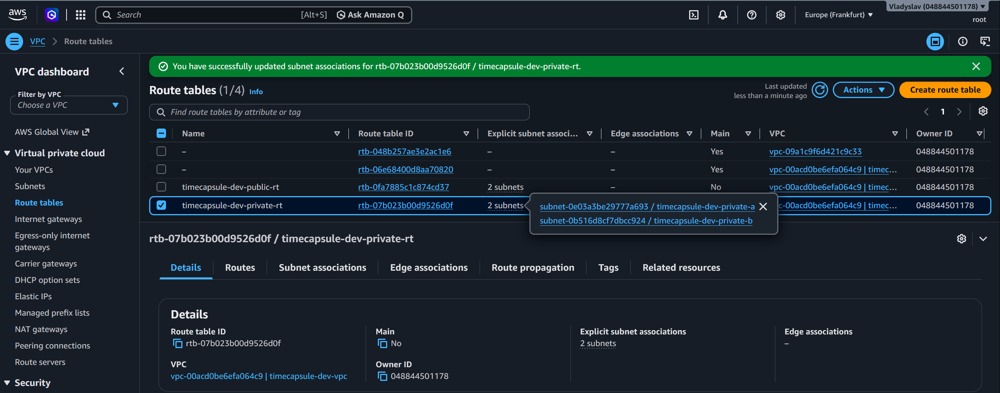

**Answer:** Both tables automatically contain `10.27.0.0/16 → local`, allowing routing within the VPC. Traffic from private-a to `8.8.8.8` has no matching external route and is dropped.

### Task 4 — Security Groups

| Group | Allowed inbound connections |
|---|---|
| `timecapsule-dev-bastion-sg` | SSH 22 from administrator IP (`/32`) |
| `timecapsule-dev-web-sg` | HTTP 80 from `0.0.0.0/0`; SSH 22 from bastion SG |
| `timecapsule-dev-db-sg` | PostgreSQL 5432 from web SG; SSH 22 from bastion SG |

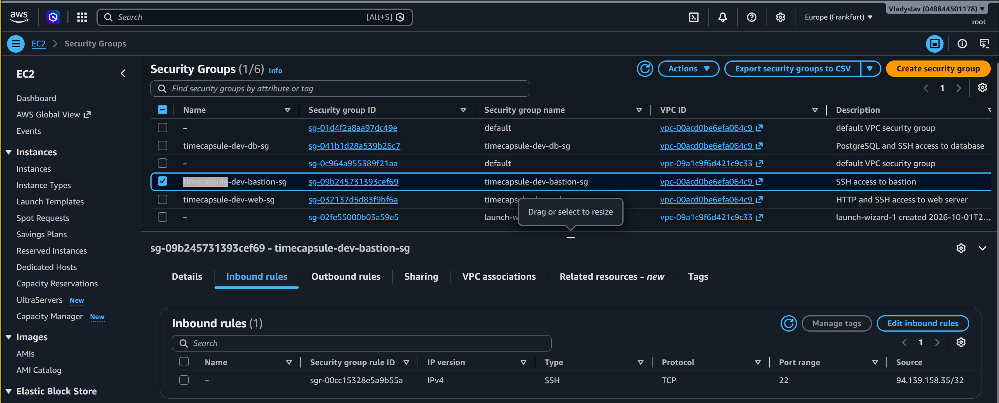
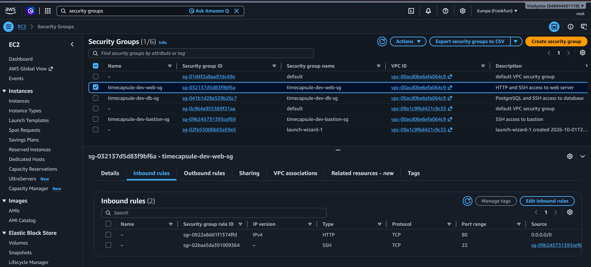
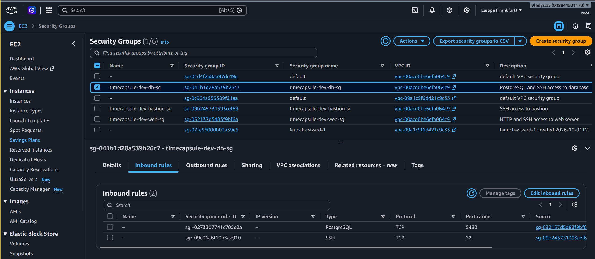

**Answer:** Referencing `web-sg` rather than a hard-coded IP restricts database clients to instances associated with that Security Group, even if their addresses change. Using the entire VPC CIDR would give substantially broader access.

### Task 5 — EC2, Nginx and bastion

Launched `timecapsule-dev-bastion` in public-b, `timecapsule-dev-web` in public-a, and `timecapsule-dev-db` in private-a (without a public IP). Used SSH `ProxyJump` to reach web/db through bastion. The web instance served an Nginx page, while installing PostgreSQL on the private DB instance failed without an outbound route.

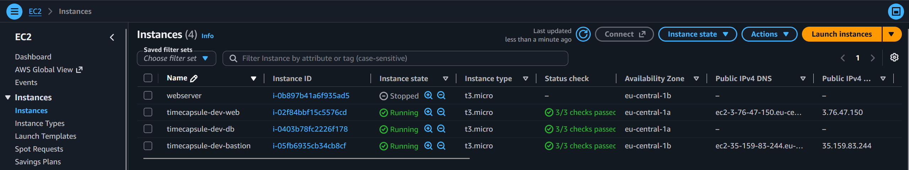
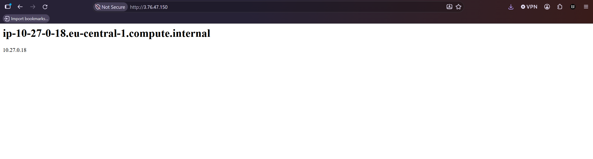
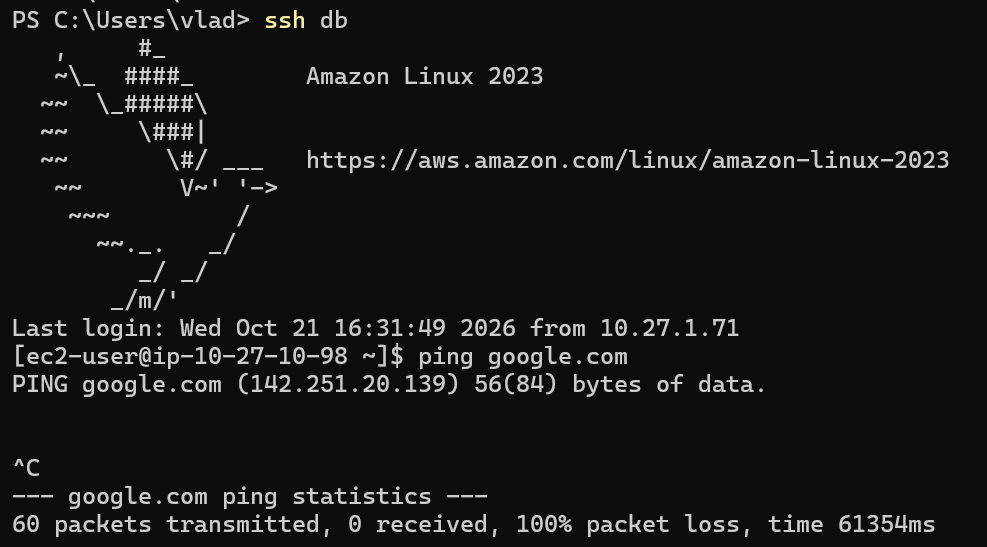

**Answer:** Web has a public IPv4 address and IGW route; DB has neither. A public NAT Gateway plus a temporary private default route gives outbound connectivity without making DB directly reachable from the internet.

### Task 6 — Temporary NAT and PostgreSQL

Created a public NAT Gateway in `public-a`, routed private outbound traffic through it, installed PostgreSQL on `db-server`, configured password authentication from `10.27.0.0/24`, and created the `student` / `lab3` test database. Afterwards NAT was deleted, the blackhole route was removed, and NAT's Elastic IP was released.

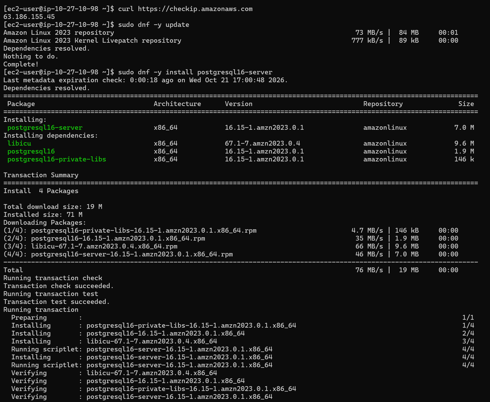
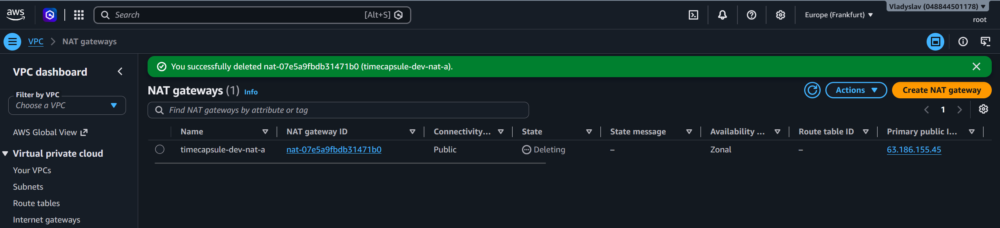
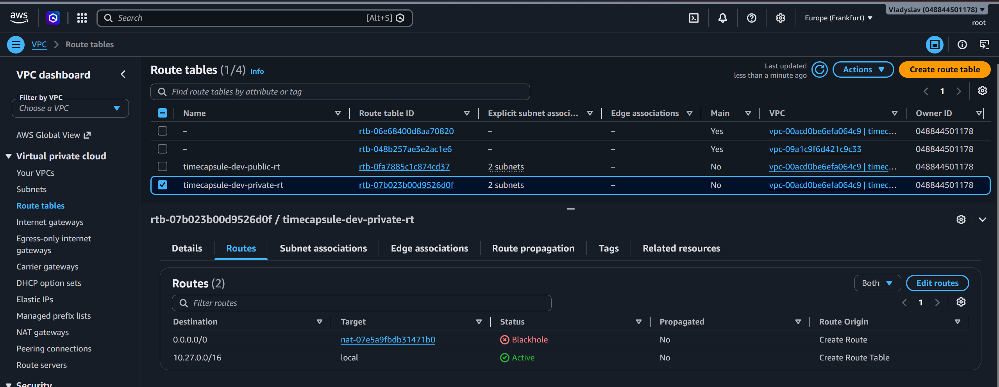

**Answers:** The external IP observed through NAT belongs to the gateway because it translates the source address. Protection is layered: network topology prevents public access, `db-sg` filters TCP sources, and `pg_hba.conf` enforces PostgreSQL host/user/database authentication. PostgreSQL continues operating after NAT deletion because application-to-database traffic uses the local VPC route; subsequent updates require another temporary NAT window.

### Task 7 — Connectivity, isolation, NACL and tags

Tested PostgreSQL access from web (`psql SELECT version()`), verified TCP 5432 is open from web and closed from bastion, and confirmed DB cannot access the public internet. A temporary NACL `Deny` rule blocked access from the administrator's IP; the rule was removed afterward. Resources were checked using the `Project=timecapsule` tag.

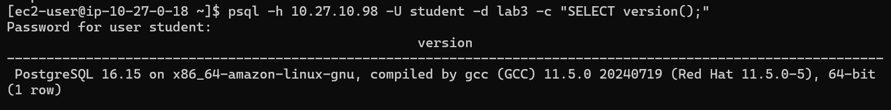
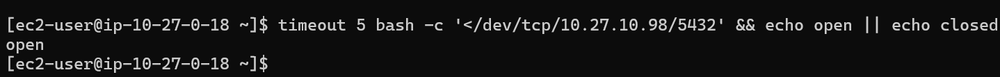
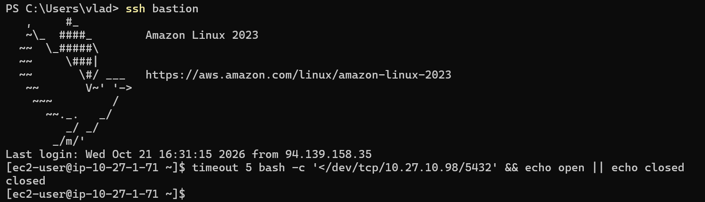
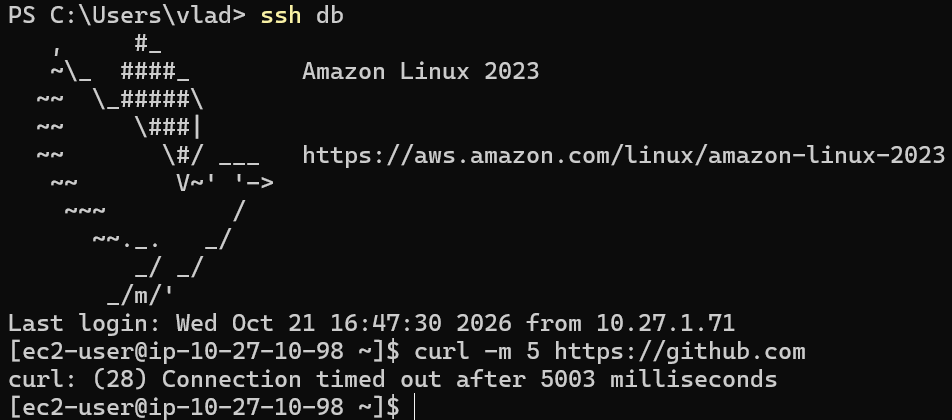
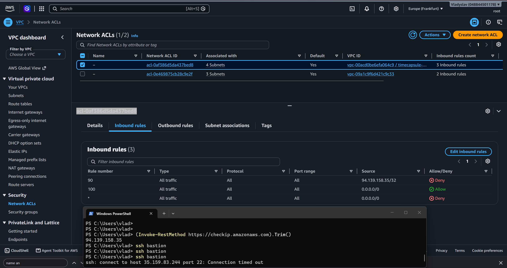
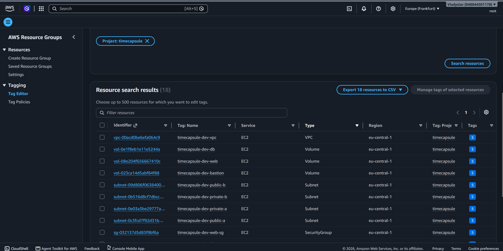

**Answers:** The route alone does not authorize TCP 5432; the DB SG allows connections from web SG but not bastion SG. NACL rules filter at subnet boundaries before SG evaluation and are evaluated in ascending rule number, so rule 90 overrides allow rule 100. A mobile client uses a different source IP, so it is not affected by the administrator's `/32` block. Tags `Project` and `Owner` identify the project's resources and their responsibility, including in shared accounts.

## Part 2 — Application migration (Tasks 8–14)

### Task 8 — Migration through AMI

Created `timecapsule-dev-app-lab2` AMI from Lab 2's `webserver`, then launched `timecapsule-dev-app` in public-a with `timecapsule-dev-web-sg`. The AMI carries the operating-system disk, installed Nginx/PHP, application code, configuration and local PostgreSQL data present on captured volumes. The database had not yet been moved to `db-server` at this stage.

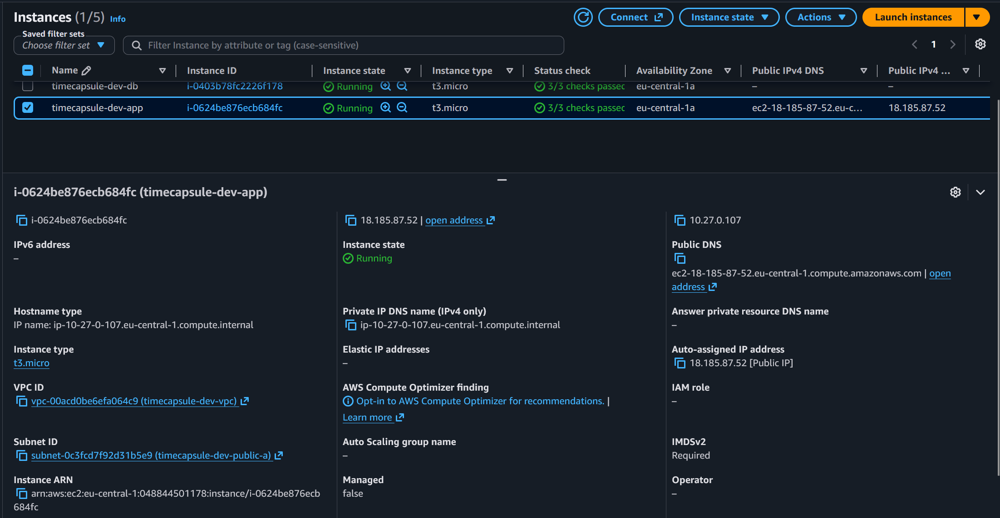

### Task 9 — Elastic IP

Assigned `timecapsule-dev-app-eip` to the new app EC2 and updated `APP_URL`. The application was accessible at the stable IP shown in the browser.

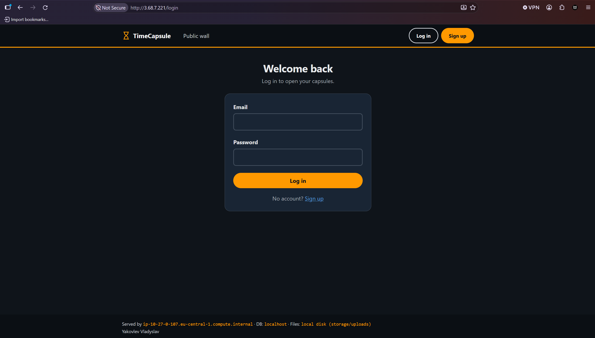

**Answers:** The public application benefits from a stable address across stop/start; bastion's address can be updated by the administrator. The lab estimates `$0.005/hour` for the public IPv4 address even while stopped. If a load balancer is introduced, clients can use its DNS name rather than an Elastic IP on the app instance.

### Task 10 — Dedicated PostgreSQL database

Created the `timecapsule` PostgreSQL role and database on private `db-server`. Tightened `pg_hba.conf` to permit only user `timecapsule` accessing database `timecapsule` from `10.27.0.0/24` with `scram-sha-256`.

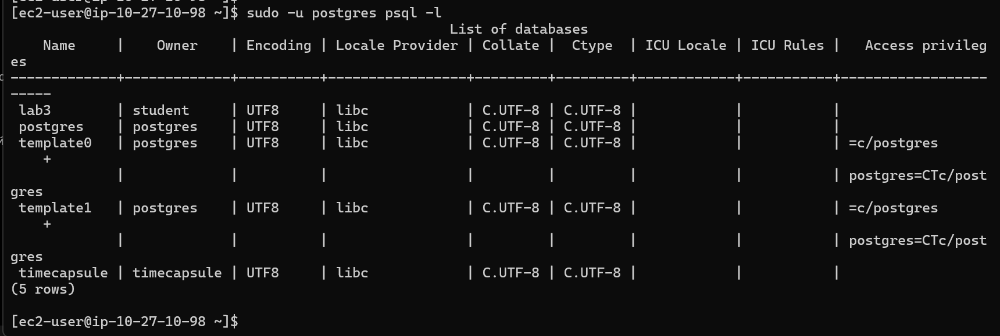
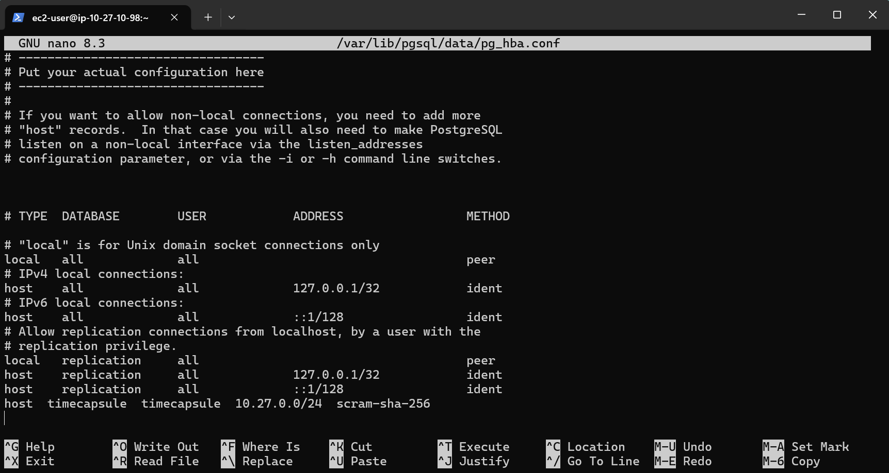

**Answer:** A strong new password is required even when a Security Group protects port 5432: a compromised allowed client or accidentally widened network rules should not automatically grant database access.

### Task 11 — Private Route 53 DNS

Associated a private hosted zone `timecapsule.internal` with `timecapsule-dev-vpc` and created an A record `db.timecapsule.internal → 10.27.10.98` with TTL 60. Name resolution works from within the VPC but not through ordinary public DNS.

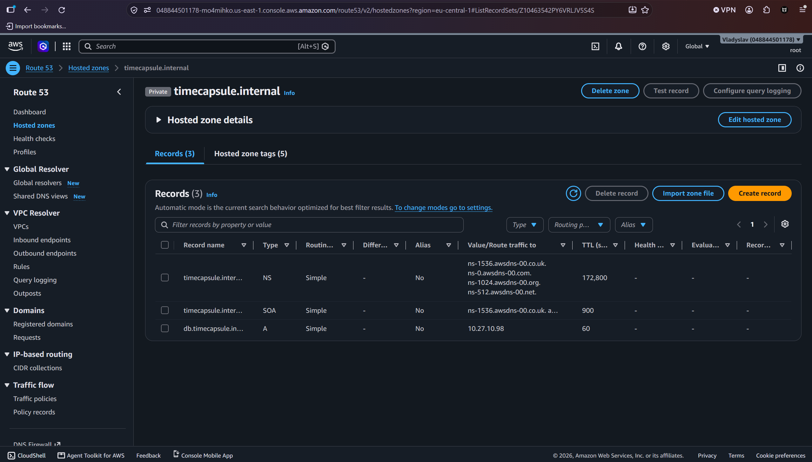
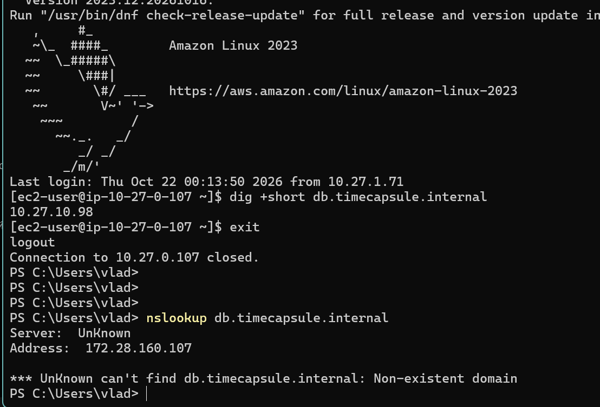

**Answers:** Route 53 private records are resolved through the associated VPC DNS, not publicly advertised. If the DB instance is recreated with another private IP, the A record must be updated.

### Task 12 — Data migration and application switchover

Exported the local `timecapsule` database with `pg_dump`; restored the SQL file on the private server using `psql -h db.timecapsule.internal -U timecapsule -d timecapsule -f timecapsule.sql`. Updated the app's DB host/password and disabled the old local PostgreSQL to ensure it uses the private DB. The application screenshot shows the existing capsules page; the supplied materials do not contain a separate screenshot of a successful `/health` response.

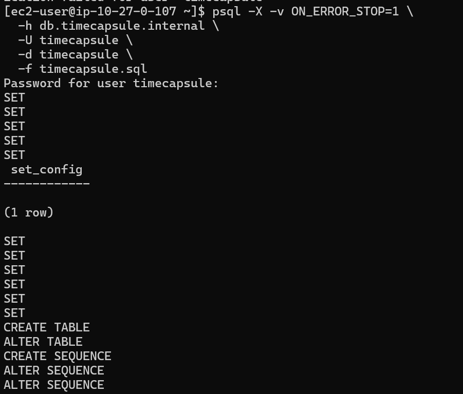
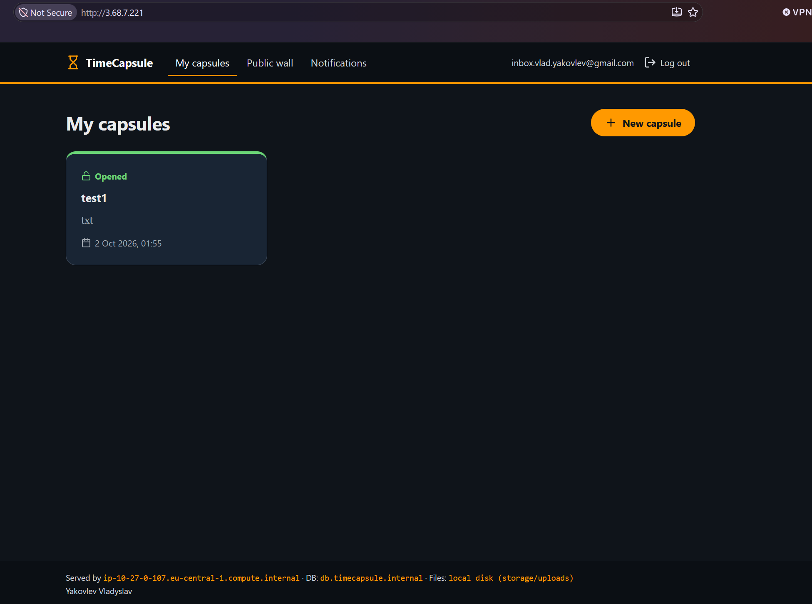

**Answer:** Uploaded files located on the app instance's EBS disk move with the AMI, not with `pg_dump`; terminating that instance may delete those files if the volume is configured for deletion on termination. Dedicated object storage or backups would reduce this risk.

### Task 13 — Deployment, failure test, DB updates (Variant A)

As required for **Informatică aplicată**, the NAT maintenance procedure was performed through the AWS Console, not shell scripts. Deployed a visible `LR3` marker, stopped the database instance and observed an application error, restarted the DB, and used a temporary NAT Gateway to run `dnf update` before removing its route, gateway and Elastic IP.

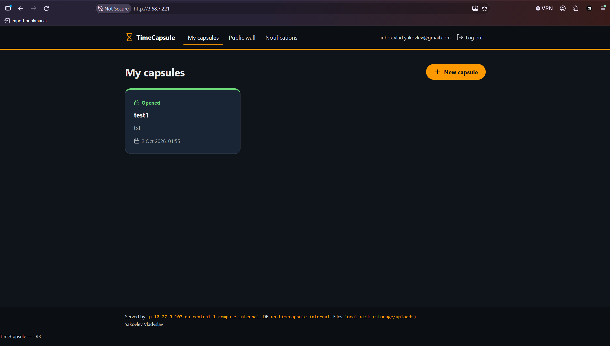
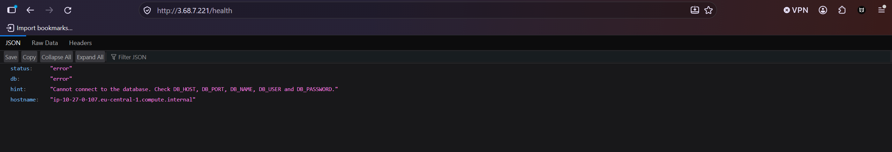
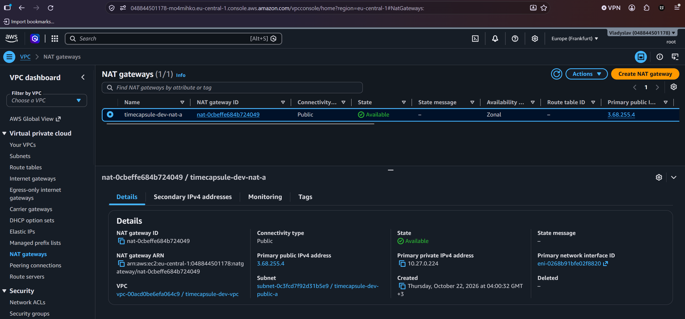
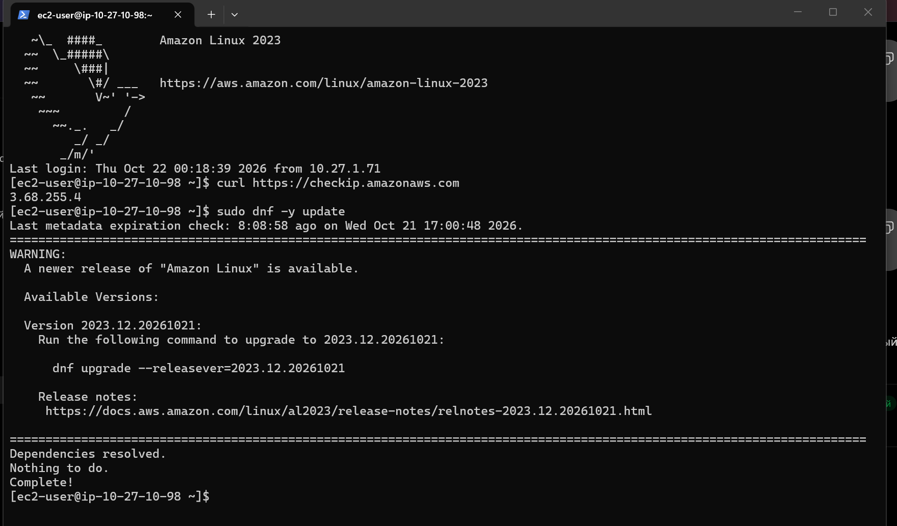

**Answers:** The deployment commands remain unchanged after the SSH connection is established; `ProxyJump` only changes how the connection reaches the instance. During DB downtime the application cannot execute database operations, and it recovers when the service is available again. A stopped-and-started EC2 instance retains its primary private IPv4 address.

### Task 14 — Architecture and ADR

The architecture illustrates two Availability Zones, four subnets, public application and bastion, private database, Internet Gateway, private Route 53, Security Groups, and temporary NAT. Database placement alternatives, trade-offs, update costs and the role of Elastic IP are recorded in [ADR-0002 — Database Placement](docs/adr/0002-database-placement.md).

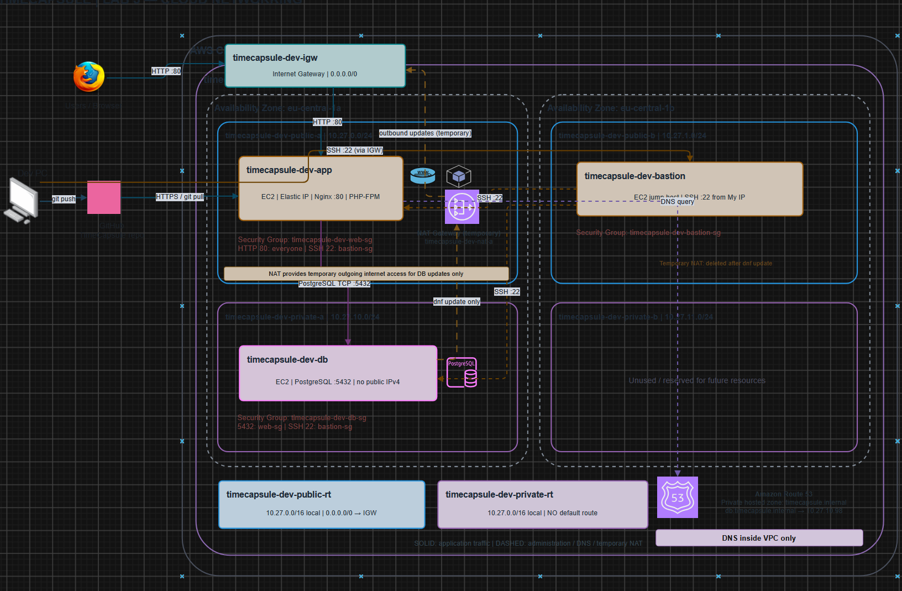

## Architecture questions (oral defense)

**1. Browser to database.** The browser requests the app's public Elastic IP over HTTP/80 via the IGW and public route table. Nginx forwards PHP requests to the application; the app resolves `db.timecapsule.internal` inside the VPC and uses TCP/5432 over the local route, permitted by the DB SG and PostgreSQL authentication.

**2. Attacker knows DB private IP.** Knowing the address is insufficient. The attacker would need network reachability inside the VPC or an allowed intermediary, to satisfy the Security Group rule, and valid database credentials; direct internet access is not available.

**3. Temporary vs permanent NAT.** Temporary NAT reduces hourly charges and avoids permanent database outbound access, but makes security updates operationally more complex and requires explicit cleanup each time.

**4. Failure of eu-central-1a.** The current app and DB both run in 1a, so that zone is a single point of failure. High availability would require app instances across multiple AZs behind a load balancer and a replicated/failover-capable database (for example, Multi-AZ database hosting), along with redundant networking as needed.

## Completion and cost control

The lab requires terminating the original Lab 2 `webserver`, stopping `bastion`, `app-server` and `db-server`, and confirming **no active NAT Gateway or allocated NAT EIP remains**. The app's Elastic IP is retained; VPC, subnets and SGs remain for later labs. **Final stopped-instance/EIP/NAT inventory screenshots were not included in the supplied archive, so this final state should be checked and documented before submission.**

> Security note: Keep `.pem` files, database passwords and `.env` out of the repository and screenshots; mask the administrator's public IP if visible.
